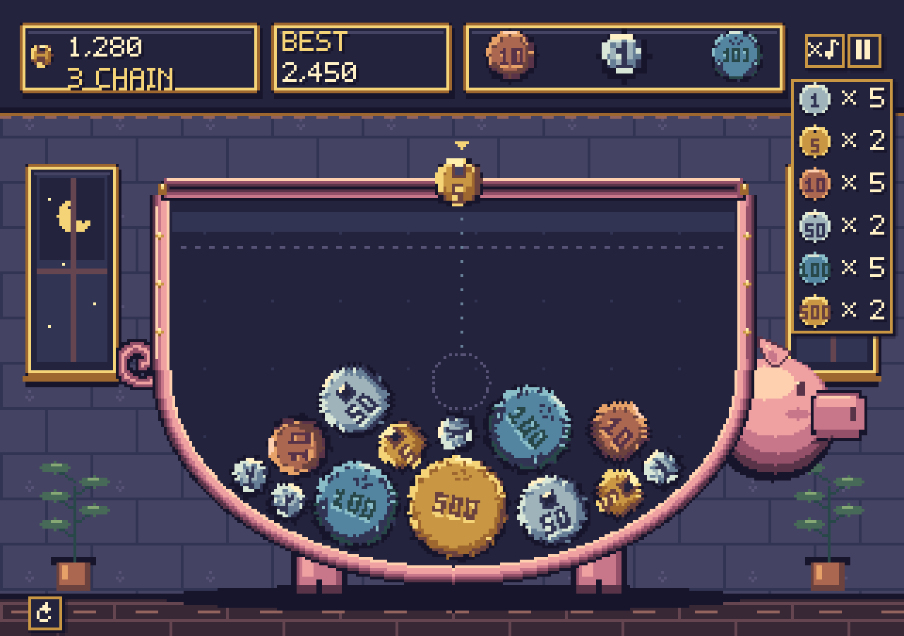

# Coin Garden / コインガーデン

Godot 4で動く、物理落下 × 両替パズルのプロトタイプです。同じ額の硬貨を必要枚数つなげて、上位の硬貨へ両替します。

画面全体をスーパーファミコン風のドット絵に統一しています。貯金箱は丸い底・足・しっぽと、右側面から右を向く小さな横顔で表現しています。顔はプレイ領域の外側にある背景のみで、当たり判定はありません。投入口は内幅いっぱいの800px、上部の壁は垂直なので左右の端まで直接落とせます。硬貨の絵柄は物理ボディの回転に追従します。上部にスコアと次の硬貨、右側に両替表を表示しています。



上部に現在のスコアとBEST（保存済みベストスコア）を常時表示します。大きなスコアはM・Bなどで短縮し、マウスを重ねると正確な値を確認できます。豚の顔の上に、各コインと両替に必要な枚数を縦に表示しています。100円は青銅をイメージした青緑色で、銀色の1円・50円と区別できます。

プレイ中は、ときどきシマリスが画面下を左右に駆け抜けたり、左下で手足を動かして踊ったりします。最初は8〜14秒後、その後は18〜32秒の間隔で交互に登場。ポーズ・開始演出・リザルト中は進行を止め、リトライで登場待ちに戻ります。コインの抽選や物理には影響しません。

## 起動

Godotで `project.godot` を開き、**F6ではなくF5（プロジェクトを実行）**を押してください。外部アドオンは不要です。Godot 4.7.2 / macOSで動作確認済み。

```sh
/Applications/Godot.app/Contents/MacOS/Godot --path .
```

## 操作

- マウス / ← → / A D：落とす位置を移動
- プレイエリア内をクリック / Space：硬貨を落とす
- タッチ：ドラッグして位置を調整し、離して落とす
- Esc / P / 右上の一時停止ボタン：一時停止・再開
- 左下の ↺：一時停止画面を開き、PLAY AGAINでリセット（CONTINUEで再開）
- 右上の ♪：BGM・効果音をまとめてミュート／解除

## ルール

| 接触してつながった硬貨 | 結果 |
| --- | --- |
| 1円 × 5 | 5円 × 1 |
| 5円 × 2 | 10円 × 1 |
| 10円 × 5 | 50円 × 1 |
| 50円 × 2 | 100円 × 1 |
| 100円 × 5 | 500円 × 1 |
| 500円 × 2 | 消去・1,000円を回収 |

同額の硬貨が接触している経路を毎物理フレームで探索します。小さな跳ね返りや見た目とのずれを吸収するため、輪郭間の8px（ドット絵の2ドット）までを接続として扱います。接触した硬貨は生成直後でも対象になり、未接触の硬貨も0.08秒後から近接判定に参加します。間接的につながった硬貨も対象です。必要枚数だけを消費し、余剰の硬貨は残します。異なる額の硬貨は接続経路になりません。5円・50円の穴は見た目のみで、物理形状は円です。

全6種類が落下候補です。出現確率は順に30%、25%、20%、12%、9%、4%。最初は必ず1円で、次の3枚を表示します。落下間隔は0.40秒です。硬貨の半径は順に32・40・48・56・66・78px。従来の約1.4倍の直径（約2倍の面積）で、盤面に滞留する枚数を減らしています。

1回の落下から次の落下が成立するまでが1ターンです。その間の両替・消去を1回ずつ連鎖に数え、時間経過では途切れません。次の落下が成立すると連鎖数がリセットされます。落下失敗・クールダウン中の入力・ポーズは連鎖を維持します。

各起爆の得点は **基本点 × 連鎖数^連鎖数**。基本点は5円・10円・50円・100円・500円への両替でそれぞれ5・10・50・100・500点、**1000円完成（500円2枚消去）は10,000点**です。回収金額は得点と分けて1,000円ずつ記録します。

| 連鎖 | 完成額 | 倍率 | この起爆の得点 |
|---|---:|---:|---:|
| 1 | 5円 | 1¹ = 1 | 5 |
| 2 | 10円 | 2² = 4 | 40 |
| 3 | 50円 | 3³ = 27 | 1,350 |
| 4 | 100円 | 4⁴ = 256 | 25,600 |
| 5 | 500円 | 5⁵ = 3,125 | 1,562,500 |
| 6 | 1000円 | 6⁶ = 46,656 | 466,560,000 |

この6連鎖の合計は468,149,495点です。10連鎖以降も得点倍率は上がります。整数演算で計算し、総得点は64ビット整数の上限9,223,372,036,854,775,807点で止めて桁あふれを防ぎます。100万点以上の表示はM・B・Tなどに省略し、スコアや結果欄にマウスを重ねると正確な値を確認できます。

落下直後の硬貨は上限判定から除外します。上限線より上に硬貨がとどまり、約2秒の猶予を超えるとゲームオーバー。ベストスコアと音の設定はGodotの `user://coin_garden.cfg` に保存します。

## 構成と調整

- `scripts/exchange_rules.gd`：額面、必要枚数、半径、出現比率、接触グラフの探索
- `scripts/coin.gd`：RigidBody2Dの物理設定
- `scripts/pig_stage.gd`：楕円の壁、投入口、両替後の硬貨を壁内へ収める処理
- `scripts/game.gd`：盤面・入力・連鎖・ゲーム状態・UI
- `scripts/game_audio.gd`：BGMループ、効果音、ミュート・一時停止・リトライ時の音声制御
- `scripts/coin_art.gd`：ドット硬貨の描画
- `scripts/coin_renderer.gd`：硬貨の絵柄を物理ボディの回転角に合わせて描画し、座標をドットに揃える
- `scripts/exchange_effects.gd`：ドットの星・得点ポップアップ
- `assets/pixel/`：背景、硬貨6種、星、オリジナルのビットマップフォント
- `assets/pixel/source/`：編集可能なパレットと画素番号（`.pixel.json`）
- `assets/audio/`：BGMとZappuで生成した8種類の効果音
- `tools/audio/`：BGM生成プロンプトと効果音のZappuパラメータ
- `tools/generate_pixel_art.py`：`draw-pixel-art`スキルのCanvas / Palette / export機能を使用する素材生成スクリプト
- `shaders/pixel_grid.gdshader`：UIも含めて4×4pxの描画グリッドに統一
- `assets/coins/` と `tools/generate_coins.py`：旧SVGデザイン。現在のゲームでは未使用

物理と入力は1280×900の論理座標のまま、描画は320×225相当のドットグリッドです。背景・硬貨・星は共通の32色パレット（透明を含む）、フォントは透明＋白のインデックス画像で制作しています。文字も同梱フォントで描画するため、システムフォントに依存しません。メニューは短い英語表記です。タッチ入力は実装済みですが、モバイル実機と縦画面向けUIは未検証です。

## ドット絵の再生成

実行には追加パッケージは不要です。素材を再生成するときだけ、インストール済みの `draw-pixel-art` スキルと `uv` を使います。

```sh
PIXEL_ART_SCRIPTS="$HOME/.codex/plugins/cache/game-development-skills/pixel-art/0.1.0/skills/draw-pixel-art/scripts"
UV_CACHE_DIR=/tmp/exchanger-uv-cache UV_PROJECT_ENVIRONMENT=/tmp/exchanger-pixel-venv \
  uv run --no-dev --project "$PIXEL_ART_SCRIPTS" python tools/generate_pixel_art.py
```

スキルの設置先が異なる場合は `PIXEL_ART_SCRIPTS` を変更してください。最初にパレットを固定し、すべての画素を色番号で描画します。PNGと編集用JSONを同時に生成します。

シマリスは `tools/generate_chipmunk.py` を同じuv環境で実行すると再生成できます。16色パレット内で描いた走り6コマ・ダンス6コマを `assets/pixel/chipmunk.png` にまとめ、`scripts/chipmunk.gd` で再生しています。`godot --headless --path . --script tests/test_chipmunk.gd` で登場間隔・一時停止・リトライ・ゲームへの非干渉を確認できます。

## Web版の書き出し

公開用リポジトリは [giginet/CoinGarden](https://github.com/giginet/CoinGarden) です。`main` にGodotプロジェクト、`gh-pages` に配信用のWASMビルドを保存しています。

`bash tools/export_web.sh` で `build/web/` にWeb版を書き出します。初回はGodot 4.7.2公式配布からシングルスレッド用Webテンプレートだけを取得します。別の場所にGodotがある場合は `GODOT_BIN` で実行ファイルを指定してください。ローカル確認は `python3 -m http.server 8765 --directory build/web` で起動し、ブラウザで開きます。

GitHub Pagesは `gh-pages` ブランチを配信します。初めて再公開する環境では `git clone --branch gh-pages --single-branch https://github.com/giginet/CoinGarden.git build/web` で配信用チェックアウトを用意し、書き出し後にこのディレクトリで変更をコミットして `git push origin gh-pages` してください。生成物は `.nojekyll` でそのまま配信されます。ブラウザでは最初にPLAYを押して起動します。デスクトップ版のセーブ保存先は維持しています。

## BGM・効果音

BGM「Coin Rush」はACE StudioのInspire Meで生成した、明るく激しいチップチューンです。実測約172 BPM・4/4拍子。音型の近い繰り返し区間を選んだ32小節（44.54秒）をループします。最後の1小節（1.38秒）で曲頭直前の音へクロスフェードし、拍ごとの位置を合わせて二重打ちを抑えています。曲頭のアタックは削りません。歌声はありません。[継ぎ目の試聴](docs/bgm-loop-preview.wav)は6秒地点でループします。

Zappuの効果音は落下・初回着地・両替・連鎖・500円2枚消去・ゲームオーバー・UI・開始ホイッスルの8種類です。両替音は金属的なチャイムを35ms・75msずらして重ねた「チャリーン」。連鎖は額面にかかわらず長調の五音音階（ド・レ・ミ・ソ・ラ）で10連鎖目まで上がり、その後は最高音を維持します。500円消去も同じ音階に従い、連鎖が切れると基準音へ戻ります。着地音は短時間の重複を抑え、消去音には専用の再生枠を確保しています。

ポーズは音声の再生位置も止め、再開時に続きから再生します。ミュート中もBGMの時間は進み、リトライでも再生位置を維持します。ゲームオーバーではBGMを止めずに0.4秒かけて3dBだけ下げ、リザルト中も同じ位置から流し続けます。リトライ時は通常音量へ戻ります。

元音源・生成プロンプト・拍解析は `tools/audio/` に保存しています。ACE Studioの作業用プロジェクトはローカル環境のみで保管しています。`python3 tools/generate_sfx.py` でZappu効果音を再生成、`python3 tools/prepare_bgm.py`（NumPy・ffmpegが必要）でループ音源を再編集できます。ゲーム実行時にこれらのアプリや外部接続は不要です。

## 開始・終了演出

開始・リトライ時はホイッスルに合わせ、厚い影を付けた「START!」が3回転しながらズームインします。大きくなりすぎて跳ね返り、約1.7秒でフェードアウト。演出中は落下・ポーズ入力を止めます。

ゲームオーバー時は、音程が下がる3打と長い余韻の「デ・デ・デーン」という約1.5秒の失敗効果音を鳴らし、盤面を停止。背景を38%ほど暗くして、スコア・ベスト・回収額・最大連鎖を載せたリザルトウィンドウが飛び出します。BGMは小音量で継続し、PLAY AGAINで開始演出からやり直せます。ミュート設定は開始・終了演出にも反映します。

## 検証

```sh
# 初回インポート
godot --headless --path . --editor --import --quit
# ルールと物理挙動の統合テスト（セーブデータは変更しません）
godot --headless --path . --script tests/test_game.gd
# 音素材の読み込み・ゲームイベント・ミュート・一時停止・リトライ
godot --headless --path . --script tests/test_audio.gd
# 指数得点・6段階の両替・ターン境界・整数上限
godot --headless --path . --script tests/test_scoring.gd
# 開始演出・入力制限・リザルト・BGM減音とリトライ
godot --headless --path . --script tests/test_transitions.gd
# サンプル盤面を実際のレンダラーで撮影
godot --path . --script tests/capture_preview.gd
```

macOSで `godot` がPATHにない場合は、`/Applications/Godot.app/Contents/MacOS/Godot` を指定してください。プレビューは `/tmp/coin-garden-preview.png`、一時停止画面は `/tmp/coin-garden-pause.png`、ゲームオーバー画面は `/tmp/coin-garden-game-over.png` に保存します。盤面とスコアは撮影用サンプルです。
